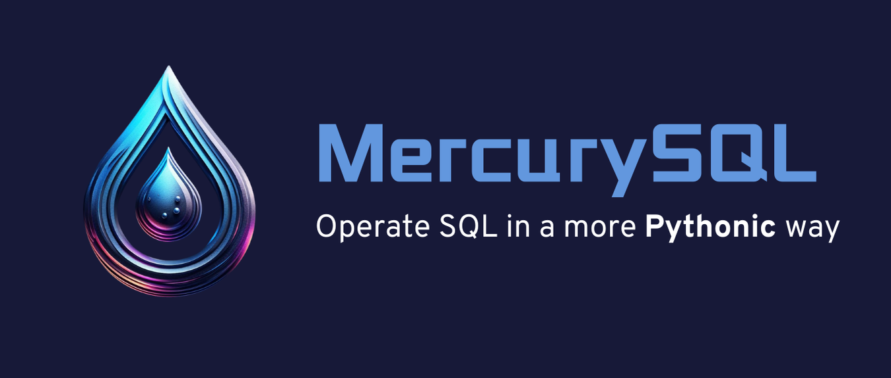

</img>
<br>
<div style="text-align: center">


</div>
<br>

[English](README.md) | 简体中文

可以在此阅读 [详细文档](https://mercurysql.readthedocs.io/en/latest/)

# MercurySQL (M.SQL)
Operate SQL in a more pythonic way.

# 是个啥
用更Python的方式操作SQL数据库。

- 被复杂无比的SQL语句弄懵？
- 因没有commit而导致数据丢失？
- 在终端里调试了几个小时的SQL？

别怕，我也是。所以MercurySQL诞生了。

MercurySQL有以下优点 ....

- **更Pythonic的操作方式**：更符合Python风格的API，使得操作SQL数据库更加简洁易懂。
- **避免复杂的SQL语句**：避免编写复杂的SQL语句，从而减少了学习和理解SQL语法的负担。
- **默认更安全**：值一律走参数绑定，表名/列名由驱动转义引用；`selection` 只接受本表的列名。具体保护到哪一步见下方「安全与可靠性说明」。
- **出错就报错**：语句失败会抛出驱动异常，而不是卡死调用方；`db.do(sql1, sql2)` 在同一个事务里执行，要么全成、要么全回滚。
- **直接使用Python进行调试**：可以在Python代码中直接调试和查看数据库操作，无需在终端中进行SQL调试。

比如说，它可以做这些事....
### 创建数据库
SQL
```sql
CREATE DATABASE IF NOT EXISTS test;
```
MercurySQL
```py
db = DataBase('test')
```

### 创建数据表
SQL
```sql
CREATE TABLE IF NOT EXISTS test (
    id INTEGER PRIMARY KEY
);
```
MercurySQL
```py
tb = db['test']  # 如果没有，会自动创建
tn.newColumn('id', int, primaryKey=True)
tb['id'] = int, 'Primary Key  # 大小写不敏感
```

### 删除数据表
SQL
```sql
DROP TABLE IF EXISTS test;
```
MercurySQL
```py
del db['test']
```

### 添加列
SQL
```sql
ALTER TABLE test
ADD COLUMN name TEXT;
```
MercurySQL
```py
table['name'] = str
```

### 添加主键列
SQL
```sql
ALTER TABLE test
ADD COLUMN id INTEGER PRIMARY KEY;
```
MercurySQL
```py
table['id'] = int, 'Primary Key'  # 'Primary Key' 这类参数对大小写不敏感
```

### 删除列
SQL
```sql
ALTER TABLE table
DROP COLUMN name;
```
MercurySQL
```py
del table['name']
```

### 添加记录
SQL
```sql
INSERT INTO test (id, name) VALUES (1, 'Bernie Huang');
```
MercurySQL
```py
table.insert(id=1, name='Bernie Huang')
```

### 查找记录
SQL
```sql
SELECT * FROM test WHERE id=1 AND name='Bernie Huang';
```
MercurySQL
```py
res = (table['id'] == 1) & (table['name'] == 'test')

print(list(res))
```

### 删除记录
SQL
```sql
DELETE * FROM test WHERE id=1 AND name='Bernie Huang';
```
MercurySQL
```py
((table['id'] == 1) & (table['name'] == 'test')).delete()
```

# 驱动（drivers）
MercurySQL 理论上可以兼容任何使用sql语言的数据库。

这是因为我们的 drivers 思想。

MercurySQL 的核心代码是通用的，但是，针对每一个数据库，都需要一个专门的驱动程序来做适配。

> Tips: 这个驱动程序的功能很简单，可以参考[Read the Docs 上的“Drivers”部分](https://mercurysql.readthedocs.io/en/latest/modules/drivers/index.html)进行开发。

设置驱动，有以下两种方法：
- 使用内置api `set_driver()`，一劳永逸地设置全局默认驱动。
```python
from MercurySQL.drivers.sqlite import Driver_SQlite   # 导入sqlite驱动
from MercurySQL import set_driver  # 导入set_driver

set_driver(Driver_SQLite)
```

- 在DataBase类中指定驱动器：
```python
Database(..., driver=Driver_SQLite)
```

# 依赖项：
MercurySQL可以使用不同的驱动器（driver），每个驱动器都有自己的依赖。
自带驱动器的依赖项如下：
* Sqlite Driver
  - sqlite3（Python自带）
* MySQL Driver
  - `pip install "MercurySQL[mysql]"`（`mysql-connector-python`，需要 MySQL 8.0.19+）

要求 Python **3.8+**。

## 安全与可靠性说明

- **值走参数绑定。** `insert()`、`update()`、`where` 条件与 `delete()` 的取值全部作为参数传给驱动，不会被拼进 SQL。
- **标识符（表名/列名）只能转义，不能参数化。** 表名、列名由驱动加引号（`"name"` / `` `name` ``）；`selection=` 只接受本表已有的列名（或列名列表），要拼任意 SQL 必须显式写 `raw=True`；自定义列类型必须是纯类型名（如 `VARCHAR(255) NOT NULL`），带引号的字符串会被拒绝，避免 DDL 注入。
- **转义不等于鉴权。** 表名/列名如果来自用户输入，仍应自己维护白名单。
- **事务。** `db.do(*sql)` 是一个事务（全成或全回滚）；要把多次调用放进同一个事务，用 `with db.transaction():`。
- **记得关闭数据库。** 用 `with DataBase(...) as db:`（或 `db.close()`）结束后台线程并关闭连接；不关闭的话，每个 `DataBase` 会一直占用一个线程和一个连接。

---

## 为什么叫做MercurySQL

*（===== 以下是ChatGPT瞎吹的，别管他 =====）*

**速度与敏捷性**： 水银（Mercury）是古罗马神话中的信使神，也是快速、灵活的代名词。通过
将"Mercury"放在库的名称中，你可能想传达这个库在处理SQL数据库时的速度和敏捷性。

**轻量级**： 水银是一种相对较轻的金属，这也可能表示你的库设计为轻量级，适用于对资源敏感的环境，如嵌入式系统或移动设备。

**流动性**： 水银在常温下是液态金属，具有良好的流动性。这可能象征着你的库提供了流畅的API，使得对SQL数据库的操作更加灵活和容易。

**精确性**： 在温度变化下，水银表现出稳定的体积，这使得它在温度计中得到广泛应用。这可能表明你的库在处理数据时是准确和稳定的，具有良好的可靠性。

**化学稳定性**： 水银是一种化学稳定的元素，不容易与其他元素发生反应。这可能意味着你的库在与其他Python 库或框架集成时是稳定且不易产生冲突的。