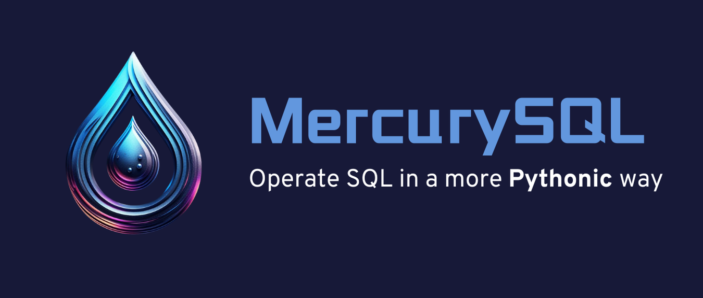

</img>
<br>
<div style="text-align: center">


</div>
<br>

English | [简体中文](README-CN.md)

Read full documentation at [Read the Docs](https://mercurysql.readthedocs.io/en/latest/)


# MercurySQL (M.SQL)
Operate SQL in a more pythonic way.

# What is it
Operate SQL database in a more **Pythonic way**.

- Confused by complex SQL statements?
- Lost data due to lack of commit?
- Spent hours debugging SQL in the terminal?

Don't worry, I've been there too. That's why MercurySQL was born.

MercurySQL has the following advantages ....

- **More Pythonic way of operation**: An API that is more in line with the Python style, making the operation of SQL databases more concise and easy to understand.
- **Avoid complex SQL statements**: Avoid writing complex SQL statements, thereby reducing the burden of learning and understanding SQL syntax.
- **Safer SQL by default**: values are always bound as parameters and table/column names are quoted by the driver; `selection` only accepts the table's own columns. See [Security notes](#security-and-reliability-notes) for exactly what is protected.
- **Fail loudly, not silently**: a failing statement raises the driver's exception instead of hanging the caller, and `db.do(sql1, sql2)` runs as one transaction (all-or-nothing).
- **Debugging with Python**: You can debug and check your database in Python directly, without complext SQL debugging in terminal.

For example, it can do these things....

### Create Database
SQL
```sql
CREATE DATABASE IF NOT EXISTS test;
```
MercurySQL
```py
db = DataBase('test')
```

### Create Table
SQL
```sql
CREATE TABLE IF NOT EXISTS test (
    id INTEGER PRIMARY KEY
);
```
MercurySQL
```py
table = db['test']
table.newColumn('id', int, primaryKey=True)
```

### Delete Table
SQL
```sql
DROP TABLE IF EXISTS test;
```
MercurySQL
```py
del db['test']
```

### Add Column
SQL
```sql
ALTER TABLE test
ADD COLUMN name TEXT;
```
MercurySQL
```py
table['name'] = str
```

### Add Primary Key Column
SQL
```sql
ALTER TABLE test
ADD COLUMN id INTEGER PRIMARY KEY;
```
MercurySQL
```py
table['id'] = int, 'Primary Key'  # 'Primary Key' is case-insensitive
```

### Delete Column
SQL
```sql
ALTER TABLE table
DROP COLUMN name;
```
MercurySQL
```py
del table['name']
```

### Add Record
SQL
```sql
INSERT INTO test (id, name) VALUES (1, 'Bernie Huang');
```
MercurySQL
```py
table.insert(id=1, name='Bernie Huang')
```

## Query
SQL
```sql
SELECT * FROM test WHERE id=1 AND name='Bernie Huang';
```
MercurySQL
```py
rec = table.select(
      (table['id'] == 1) & \
      (table['name'] == 'test')
)   # rec = [{'id': 1, 'name': 'Bernie Huang'}]
```

### Delete Record
SQL
```sql
DELETE * FROM test WHERE id=1 AND name='Bernie Huang';
```
MercurySQL
```py
((table['id'] == 1) & (table['name'] == 'test')).delete()
```

# Dependencies:
- sqlite3 (for Driver_SQLite, comes with Python)

  So ... no dependencies for SQLite!

- `pip install "MercurySQL[mysql]"` for the MySQL driver
  (`mysql-connector-python`, MySQL 8.0.19+).

Requires Python **3.8+**.

## Security and reliability notes

- **Values are parameters.** `insert()`, `update()`, `where` conditions and
  `delete()` bind every value; nothing user-supplied is concatenated into SQL.
- **Identifiers are quoted, not parameters.** Table and column names are quoted
  (`"name"` / `` `name` ``). `selection=` only accepts the table's own column
  names, or a list of them; arbitrary SQL needs the explicit `raw=True` opt-out.
  A custom column type must be a plain SQL type (so it cannot smuggle DDL).
- **Quoting is not authorization.** Do not build table/column names from
  untrusted input without your own allow-list.
- **Transactions.** `db.do(*sql)` is all-or-nothing. Use
  `with db.transaction():` to group several calls.
- **Close your database.** `with DataBase(...) as db:` (or `db.close()`) stops
  the background thread and closes the connection; otherwise one thread and one
  connection per `DataBase` stay alive for the life of the process.

---

## Why is it called MercurySQL

*(===== The following is just some fun speculation by ChatGPT, don't mind it =====)*

**Speed and Agility**: Mercury is the messenger god in ancient Roman mythology, and is synonymous with speed and flexibility. By putting "Mercury" in the name of the library, you might want to convey the speed and agility of this library when handling SQL databases.

**Lightweight**: Mercury is a relatively light metal, which may indicate that your library is designed to be lightweight, suitable for resource-sensitive environments such as embedded systems or mobile devices.

**Fluidity**: Mercury is a liquid metal at room temperature, with good fluidity. This may symbolize that your library provides a smooth API, making operations on SQL databases more flexible and easy.

**Accuracy**: Under temperature changes, mercury shows a stable volume, which makes it widely used in thermometers. This may indicate that your library is accurate and stable when handling data, with good reliability.

**Chemical Stability**: Mercury is a chemically stable element and does not easily react with other elements. This may mean that your library is stable and not prone to conflicts when integrated with other Python libraries or frameworks.
